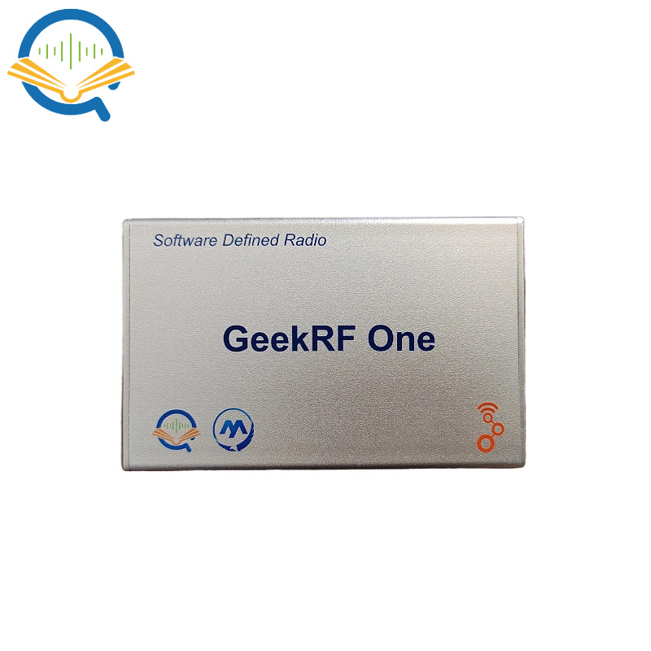
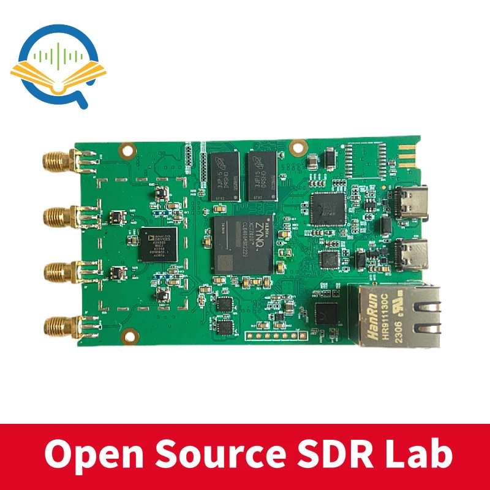

# GeekRF-One

Firmware and documentation for the **OpenSourceSDRLab GeekRF One**, a PlutoSDR-compatible software-defined radio of the PlutoSky series with a Zynq-7020, an AD9363 transceiver (2 transmit, 2 receive channels, 70 MHz to 6 GHz), Gigabit Ethernet and a TF card slot.

  
  

## Product link

<https://opensourcesdrlab.com/products/geekrf-one-ad9363-zynq7020-plutosdr>

## User manual

- GeekRF One User Manual: <https://blog.opensourcesdrlab.com/archives/geekrf-one-user-manual>

## About the board

- RF transceiver: Analog Devices **AD9363**, used over the AD9361 tuning range of **70 MHz to 6 GHz**; RF bandwidth 200 kHz to 56 MHz; 12-bit ADC/DAC
- Channels: **2 transmit and 2 receive** (2×2 MIMO), full duplex, SMA connectors TX1, RX1, TX2, RX2
- SoC: Xilinx Zynq **XC7Z020** (CLG400), 512 MB DDR3, 32 MB QSPI flash, **TF card** slot
- Interfaces: **Gigabit Ethernet**, USB Type-C **OTG** port, USB Type-C **Serial** port (serial console and USB-JTAG)
- Clocking: **0.5 ppm TCXO**, VCTCXO supported
- Firmware: PlutoSDR firmware v0.37 in the on-board flash; the TF card holds Analog Devices Kuiper Linux with the GeekRF One boot files
- Works with libiio, IIO Oscilloscope, GNU Radio, SDR#, SDRangel, MATLAB and other PlutoSDR software
- Aluminium alloy case

## Quick start

1. Install the PlutoSDR USB drivers from Analog Devices (Windows).
2. Connect a USB Type-C cable to the **OTG** port, or connect Ethernet and a USB cable to the **Serial** port.
3. Open IIO Oscilloscope, GNU Radio or another PlutoSDR program and connect to the device.

The connection methods, the TF card and the procedure to re-install the on-board flash firmware are in the **[Quick Start Guide](docs/Quick-Start-Guide.md)** ([PDF](docs/Quick-Start-Guide.pdf)). Software tutorials for Windows and Ubuntu are in the user manual.

## Repository layout

| Path | Contents |
|---|---|
| `docs/` | Quick Start Guide (Markdown and PDF) |
| `images/` | Product photos |

## Downloads (Releases)

The firmware files are attached to the [Releases](../../releases) page instead of being stored in the repository:

| File | Contents |
|---|---|
| `GeekRF-One_TF-card-boot-files.zip` | `BOOT.BIN` and `image.ub` for the TF card (Kuiper Linux), and `uImage` |
| `GeekRF-One_flash-firmware_v0.37.zip` | Files to re-install the on-board flash: the `burn_flash` folder, PlutoSDR firmware v0.37 (`pluto.dfu`, `boot.dfu`, `uboot-env.dfu` and `.frm` files) and the DFU script `UPDATE.BAT` |
| `SHA256SUMS.txt` | SHA-256 checksums of the files above |

Check a download with `shasum -a 256 -c SHA256SUMS.txt` (macOS / Linux) or `certutil -hashfile <file> SHA256` (Windows).

The same files are in the OpenSourceSDRLab download center: <https://www.opensourcesdrlab.cn/en/download.html#p=geekrf-one>

## Licence

Files created by OpenSourceSDRLab are released under the [Apache License 2.0](LICENSE). The firmware is built from the Analog Devices PlutoSDR firmware, Linux, U-Boot and buildroot and remains under their own licences (mostly GPL). See [NOTICE.md](NOTICE.md).

## Support

- Email: support@opensourcesdrlab.com
- Forum: <https://forum.opensourcesdrlab.com>
- Discord: <https://discord.gg/nnxY6DkmvT>
- Blog and user manuals: <https://blog.opensourcesdrlab.com>

---
© 2026 OpenSourceSDRLab. All rights reserved. · <a href="https://www.opensourcesdrlab.com">www.opensourcesdrlab.com</a>
